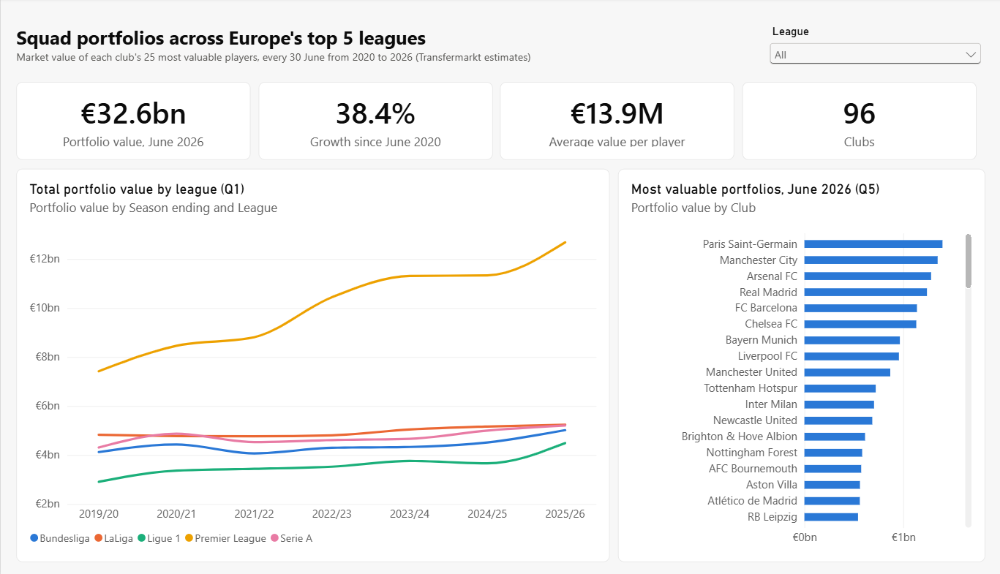
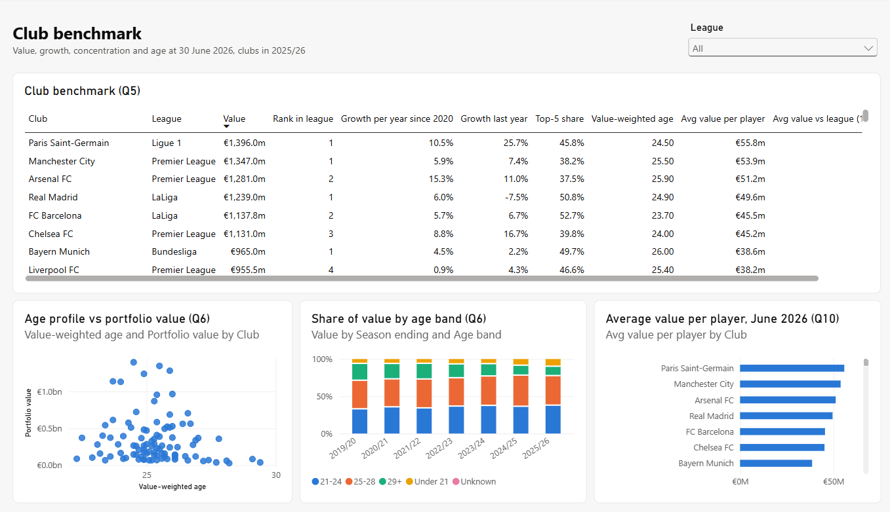
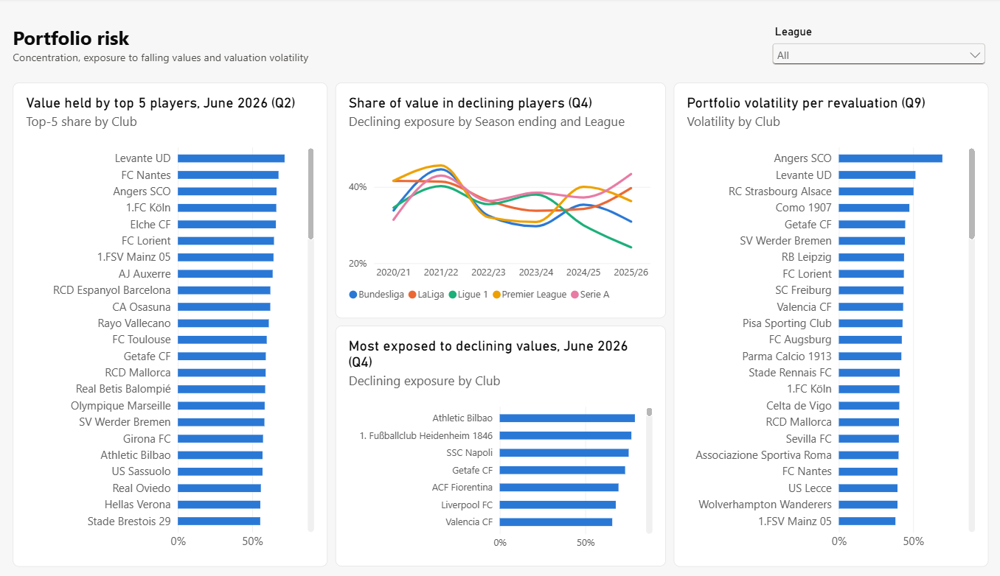
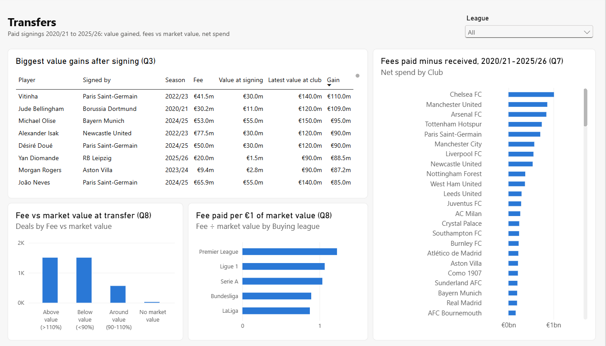
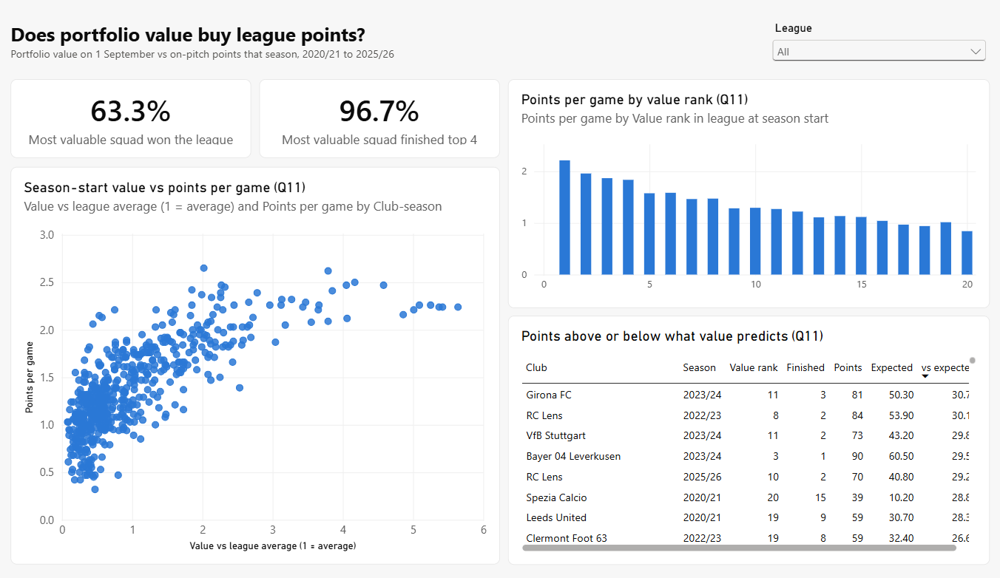
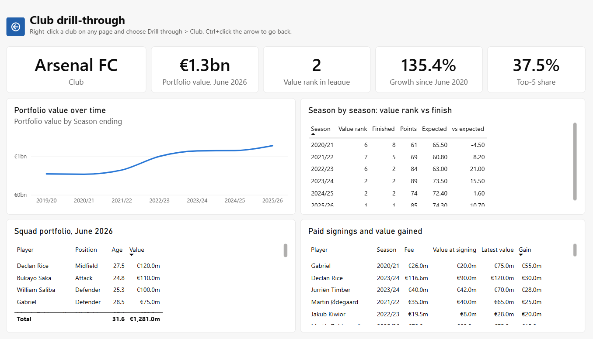

# Dashboard walkthrough

How to open and use the Power BI dashboard, what each page shows, and a 5-minute talk track for presenting it.
The answers behind it are in [`findings.md`](findings.md); what to do about them is in [`recommendations.md`](recommendations.md).

---

## Open it

1. Make sure the database is built (README steps 1 to 5) and SQL Server Express is running.
2. Open `powerbi/FootballPortfolio.pbip` in Power BI Desktop.
3. If the charts are empty, click **Home → Refresh**. The first time, Power BI may ask how to connect to
   `localhost\SQLEXPRESS`: choose **Windows → Use my current credentials**, and accept the unencrypted connection
   if asked (it is a local database).
4. Optional check: `powershell -File powerbi\check_model.ps1` compares 9 headline numbers with SQL; all should say OK.

## Getting around

| To | Do this |
|---|---|
| Change page | Click the tabs at the bottom: Overview, Club benchmark, Risk, Transfers, Value vs points, Club |
| Look at one league | Use the **League** dropdown at the top right of each page (it applies to that page) |
| See exact values | Hover over any bar, line point or scatter dot |
| Look at one club | Right-click the club in any chart or table and choose **Drill through → Club** |
| Go back after drilling | Ctrl+click the arrow at the top left of the Club page (in Power BI Desktop) |
| Sort a table | Click a column header |

"Latest" figures (cards, the ranked bar charts) use the most recent 30 June in the data, currently June 2026.

---

## Page by page

### 1. Overview (Q1, Q5)

- **Cards:** total portfolio value in June 2026 (€32.6bn), growth since June 2020 (38.4%), average value per player
  (€13.9M) and the number of clubs (96).
- **Line chart:** total value by league each 30 June. The Premier League pulls away (€7.4bn to €12.7bn) while the
  other four stay between about €3bn and €5bn.
- **Bar chart:** clubs ranked by portfolio value, led by PSG, Manchester City and Arsenal.
- **Try:** pick LaLiga in the League dropdown; the cards and bars switch to that league, with Real Madrid and
  Barcelona far ahead of everyone else.

### 2. Club benchmark (Q5, Q6, Q10)

- **Table:** every club in 2025/26 with value, rank in league, growth per year since 2020, last year's growth,
  top-5 share, value-weighted age, average value per player and that average against the league (100 = average).
  Scroll right for the last columns.
- **Scatter:** value-weighted age against portfolio value. There is no strong pattern (correlation -0.16): age alone
  doesn't make a squad valuable.
- **Stacked columns:** share of value by age band each year. The 29+ band shrinks from 22.6% to 12.6%.
- **Bars:** average value per player, led by PSG (€55.8m).
- **Try:** sort the table by "Growth per year since 2020" to find the fastest growers (Lens, Stuttgart, Strasbourg).

### 3. Risk (Q2, Q4, Q9)

- **Left bars:** share of value held by each club's five most valuable players. Levante (71.8%) and Nantes (67.7%)
  are the most dependent on a few players.
- **Line chart:** share of value in players worth less than a year earlier, by league. It peaked in 2022.
- **Middle bars:** clubs most exposed to falling values in June 2026, led by Athletic Bilbao.
- **Right bars:** portfolio volatility, how much a typical player's value moves at each revaluation. Small, young
  squads swing most (Angers, Levante); elite squads are steadiest.
- **Try:** filter to the Premier League; concentration is lower across the board.

### 4. Transfers (Q3, Q7, Q8)

- **Table:** paid signings ranked by value gained at the buying club. Vitinha (+€110m at PSG) and Bellingham
  (+€109m at Dortmund) lead.
- **Columns:** how fees compare with market value. Above value and below value are equally common (41.8% each); only
  15.6% of deals land within 10%.
- **Bars, bottom:** fee paid per €1 of market value by buying league. Premier League clubs pay most (1.23).
- **Bars, right:** net spend (fees paid minus received), led by Chelsea (+€1.01bn).
- **Try:** right-click Chelsea in the net spend chart and drill through to its Club page.

### 5. Value vs points (Q11)

- **Cards:** the most valuable squad won its league 63.3% of the time and finished top 4 96.7% of the time.
- **Scatter:** each dot is a club-season: squad value against the league average (1 = average) on 1 September,
  against points per game that season. The upward curve is the answer to Q11.
- **Columns:** points per game by value rank. Rank 1 averages 2.2; it falls steadily to about 0.9 at rank 20.
- **Table:** club-seasons above or below the points their value predicts. Girona 2023/24 (+30.7) tops it.
- **Try:** sort the table by "vs expected" ascending to see the biggest underperformers (Schalke 2020/21, Chelsea
  2022/23, Tottenham 2024/25).

### 6. Club (drill-through)

- Opens on whichever club you drilled from (Arsenal if opened directly).
- **Cards:** the club's portfolio value, rank in its league, growth since 2020 and top-5 share.
- **Line chart:** its portfolio value each 30 June.
- **Season table:** value rank at the start of each season against where it finished, and points against
  expectation.
- **Squad table:** its 25 most valuable players in June 2026, with ages and values.
- **Signings table:** every paid signing since 2020/21 and the value it gained or lost.

---

## 5-minute talk track

| Time | Page | Say |
|---|---|---|
| 0:00-0:45 | Overview | "I treated each club's squad as an investment portfolio: players are the assets, Transfermarkt values the prices. The top 5 leagues' portfolios grew 38% in six years to €32.6bn, and the Premier League took most of that growth." |
| 0:45-1:45 | Value vs points | "First question: does value buy results? Largely yes. Season-start value explains 60% of points per game, and the most valuable squad won the league 19 times in 30. But Girona and Lens finished far above their value, and Chelsea and Spurs far below." |
| 1:45-2:45 | Transfers | "So how do you build value? Not by paying premiums: Premier League clubs pay €1.23 per €1 of market value. Buy young instead: 72% of players signed under 23 gained value, against 12% of those signed at 27 or older." |
| 2:45-3:45 | Risk | "Then manage the risk. Some clubs hold two-thirds of their value in five players. A third of all value is in players already falling, so selling before the decline matters." |
| 3:45-4:30 | Club (drill through from Arsenal or Lens) | "Here is one club end to end: value over time, where it finished against its value each season, and which signings made or lost money." |
| 4:30-5:00 | Back to Overview | "The takeaway: spending more doesn't buy points beyond what value predicts (correlation -0.02 across 61 clubs). Buying young, near market value, and selling on time does." |

---

## Updating the data

1. Download the latest Kaggle dataset into `C:\data\player-scores`.
2. Run README steps 2 to 6 (load, build, check, model, questions).
3. Open the dashboard and click **Refresh**. The "latest" cards and charts move to the newest 30 June by themselves.
4. If you change the SQL views or the pages, re-run `powerbi/build_pbip.py` before opening the dashboard.
